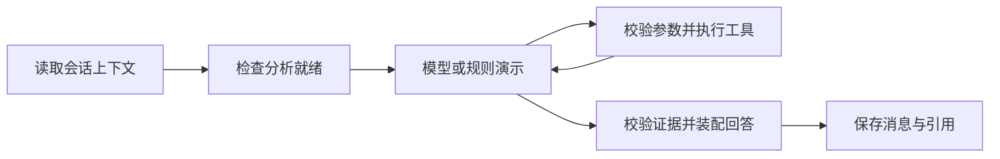

# 架构与实现决策

React 通过同源 `/api` 调用 FastAPI。生产构建由 API 托管，开发用 Vite 代理。API 的同步路由在线程池执行，不阻塞事件循环；视觉工作全部交给独立 worker。SQLite 使用 WAL、busy_timeout 和外键约束。

视觉链路：媒体探测与 SHA-256 → 持久 queued 任务 → 条件更新领取并提交 → adapter → Schema/语义验证 → 原子结果文件 → 单事务发布轨迹、区间、片段和成功状态。心跳过期任务失败，重试新建分析保留旧记录。command 使用管理员 JSON argv 与进程组超时终止，禁用 shell。

统计核心是 `backend/app/core.py` 的纯函数。时间采用半开区间，区间并集一致性校验。unknown、未观察、已识别分别计算；跨轨迹不把同时出现误认为冲突。多头牛返回独立统计，不制造牛群百分比。

实际图定义在 `backend/app/agent.py`，可视化源码见 `agent-graph.mmd`：

工具参数由协议校验，analysis_id 只由会话注入。每轮最多 6 次工具、4 次 provider 调用，默认 90 秒 deadline；API 请求最多 30 秒，非法最终 JSON/引用最多修复一次。工具输出绑定会话/分析，事实卡数值与媒体位置由服务端填入。规则 provider 只规划工具与引用，不直接填统计值。详细调用保存在 tool_calls；界面只展示工具名、状态和耗时。

除规定的三个视频工具外，增加 **history 命名空间**和 `query_history` 工具，以满足用户五天真实记录需求。history 会话 analysis_id=null，通过显式历史牛号和日期访问现有只读库；不把单视频轨迹拼成历史身份。视频工具严格使用原 07 协议；历史扩展返回 history_refs/history_records，不挤入视频秒偏移字段。知识索引同时包含 80 份牛日汇总，精确时间窗仍使用结构化查询。

RAG 在 API 进程的单线程有界执行器串行索引，本地 Chroma 用互斥锁统一访问。DB 当前版本作为检索可见性最终依据。向量 collection 指纹包含 embedding URL、模型、维度和索引版本；同维度不同模型也不会混查。lexical 与 vector 阈值分离。

会话输入通过独立 chat_turns 的 `(session_id,client_message_id)` 唯一约束幂等，user/assistant 不共享消息唯一约束。会话并发由进程锁和持久 processing 状态保护。单 API 进程是明确部署约束。重启中断消息记为失败；历史记录和引用继续可读。

普通 JSON 使用 Envelope，核心 DTO 由 Pydantic 定义并导出 OpenAPI，再生成前端 TypeScript 类型。媒体与附件不封装；SPA 回退不吞 API 404；外链只接受 HTTP/HTTPS，文件路径仅留在服务端。
